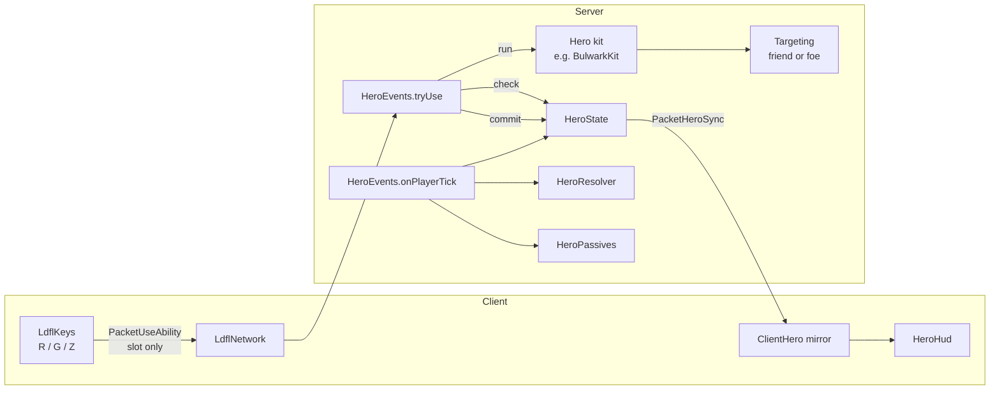

# Architecture

How LDFL is put together, for anyone reading or changing the code. The package root is
`com.micatechnologies.minecraft.ldfl`.

## Packages

| Package | What lives there |
| --- | --- |
| `hero.core` | The rules: `Role`, `AbilitySlot`, `AbilitySpec`, `HeroSpec`, `HeroState`, `HeroResolver`, `Aim`. **Pure Java, no Minecraft types at all** |
| `hero` | The Minecraft side of heroes: `HeroRegistry` and `Heroes` (every hero defined in one place), the `HeroData` capability, `HeroEvents` (the tick loop, passives, ult charge), `HeroPassives`, `Targeting`, `HitScan`, and the Wounded and Marked effects |
| `hero.<name>` | One package per hero with its kit class: the server-side behaviour of its abilities |
| `item` | Signature items (`ISignatureItem`) and the hero weapons |
| `entity` | Barrier, sentry, bolt, heal beam, flask, ward bell |
| `block` | Decor blocks, the Mending Station, Upheaval Stone |
| `network` | `PacketUseAbility` (client to server) and `PacketHeroSync` (server to client) |
| `client` | Keybinds, the HUD, the client hero mirror, entity renderers. Client-only |
| `command` | `/ldfl` |

## Rules the code depends on

These are the load-bearing rules. Break one and something fails somewhere far from the change.

### 1. `hero.core` never imports a Minecraft type

The cooldown, ultimate and hero-resolution rules are plain Java, so they are unit-tested on a bare
JVM in seconds (`HeroStateTest`, `HeroSpecTest`, `HeroResolverTest`, `AimTest`). Anything that
needs a player, a world or an item belongs one package up, in `hero`.

### 2. Common code never touches client-only classes

A `net.minecraft.client` import in common code compiles fine and works in singleplayer, then
crashes a **dedicated server** on start. Client code is reached only through
`LdflClientProxy`. The PR workflow boots a real dedicated server to catch this.

### 3. The server is authoritative

The client sends only "slot N pressed". The server checks the hero, the cooldown and the ult
charge, runs the ability, and syncs the result back. The client mirror (`ClientHero`) ticks
cooldowns down locally purely so the HUD counts smoothly between syncs.

`HeroState` splits activation into `check(slot)` and `commit(slot)`: an ability whose `activate`
returns `false` (nothing to do) costs nothing.

### 4. Hero data is never persisted

Your hero comes from what you hold, resolved every tick by `HeroResolver` (main hand wins). The
`HeroData` capability is not saved, and the Tank passive's attribute modifiers are marked unsaved
for the same reason. `HeroPassives.reconcile`, which runs on the first tick after login and on
every hero change, always removes before it adds, so it is idempotent and repairs any stale
modifier.

### 5. Friend or foe goes through `Targeting`

Every ability, the sentry, the barrier and the passives call `Targeting.isEnemy` and
`Targeting.isAlly`. Hostile mobs are always enemies; players only when `combat.pvp` is on and
they are not on the same scoreboard team. Never test "is this a player" or "is this a mob" in a
kit directly.

## The tick loop

`HeroEvents.onPlayerTick`, on the server, at the end of every player tick:

1. Resolve the active hero from both hands.
2. If it changed (or on the first tick), reconcile passives and reset state.
3. Tick cooldowns; run the Support regeneration if the role is Support.
4. Call `cleanup` on **every other** hero (so a barrier drops, a beam stops, an anchor ends), then
   `tick` on the active one, which also sets the HUD resource bar.
5. Sync to the client if anything changed, and every two seconds regardless.

## Ultimate charge

`HeroEvents.onLivingDamage` credits the attacker with `min(damage, target's health)`, so overkill
does not count, and applies Wounded for Damage heroes. Healing is credited through
`HeroEvents.creditHealing` by the abilities that heal, with only the healing that landed.

## Configuration

`LdflConfig` is a Forge `@Config` class. Values are read at the moment they are used (cooldowns
through an `IntSupplier` on `AbilitySpec`, ult costs through a `DoubleSupplier` on `HeroSpec`),
which is why a config-screen change applies live. Keep them as suppliers: capturing a value at
registration would freeze it.
