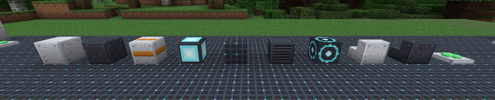
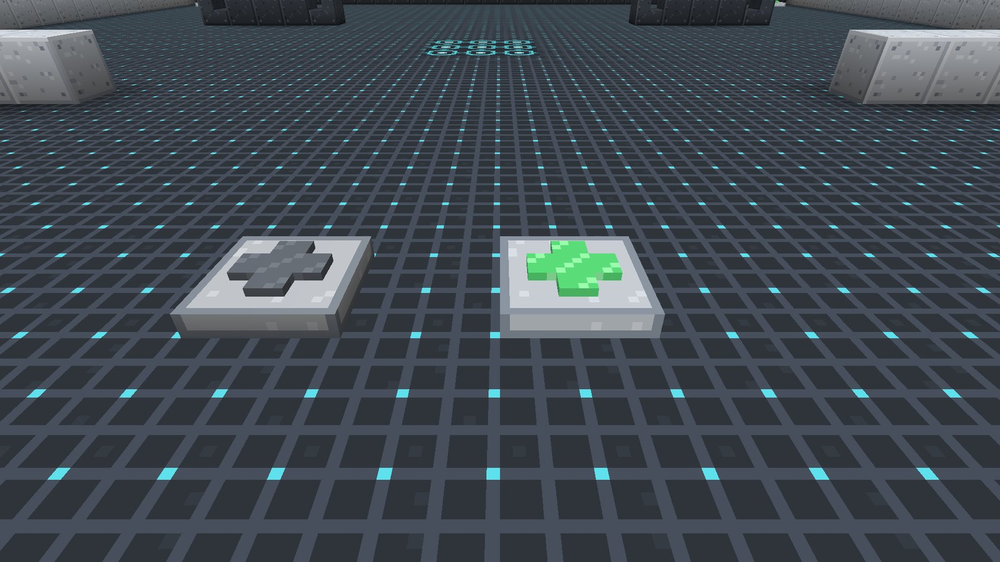
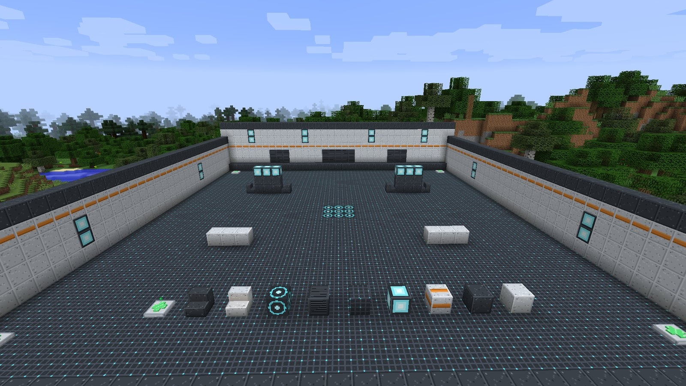
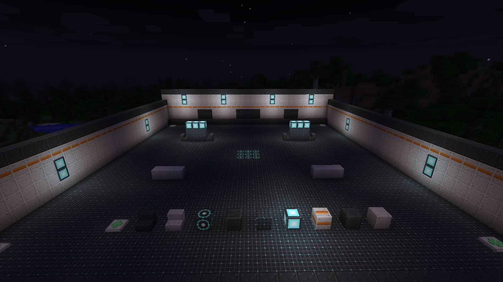

# Building set

LDFL comes with a small set of **futuristic decor blocks** for building arenas, bases and
training rooms, plus the **Mending Station**, a floor pad that heals. Every block is craftable and
appears in the **Frontline Heroes** creative tab.

## The blocks

| Block | | Notes |
| --- | --- | --- |
| **Light Hull Panel** |  | The base wall block. Crafted from stone and iron, and the starting point for the rest of the set |
| **Dark Hull Panel** |  | Darker panelling for floors, trims and contrast |
| **Accent Hull Panel** |  | A light panel with an orange stripe, for wall bands and markings |
| **Lumen Panel** |  | A glowing light panel: a full-strength light source |
| **Grid Floor** |  | Dark floor plating with a cyan grid |
| **Vent Panel** |  | A slatted vent, for walls and machinery |
| **Objective Pad** |  | A floor marker with cyan rings, for capture points and spawn pads |
| **Light Hull Panel Stairs** |  | Stairs in the light panel |
| **Dark Hull Panel Stairs** |  | Stairs in the dark panel |
| **Mending Station** |  | A healing floor pad. See below |

All of them are mined with a pickaxe.

## Mending Station

A low pad with a cross on top. **Step on it while hurt** and it heals you **8 health** (four
hearts). Then the cross goes dark while it recharges for **10 seconds**, and lights up again with
a soft chime when it is ready.

- It works for **any player**, hero or not.
- It only fires if you are actually hurt, so walking over it at full health does not waste it.
- You can see from across the room whether a station is ready: green means go.

## Day and night

## Recipes

<!-- recipe:hull_panel_light -->

StoneStoneStoneStoneIron IngotStoneStoneStoneStone

→
8

<!-- /recipe -->
<!-- recipe:hull_panel_dark -->

Coal

→
8

<!-- /recipe -->
<!-- recipe:hull_panel_accent -->

Orange Dye

→
8

<!-- /recipe -->
<!-- recipe:lumen_panel -->

Glowstone

→
4

<!-- /recipe -->
<!-- recipe:grid_floor -->

→
4

<!-- /recipe -->
<!-- recipe:vent_panel -->

Iron Bars

→
4

<!-- /recipe -->
<!-- recipe:objective_pad -->

→
4

<!-- /recipe -->
<!-- recipe:hull_panel_light_stairs -->

→
4

<!-- /recipe -->
<!-- recipe:hull_panel_dark_stairs -->

→
4

<!-- /recipe -->
<!-- recipe:mending_station -->

RedstoneGlistering MelonRedstone

→

<!-- /recipe -->

Everything starts from **Light Hull Panels** (eight stone around an iron ingot). Dark panels add
coal, accent panels add orange dye, and the rest are built from those.
