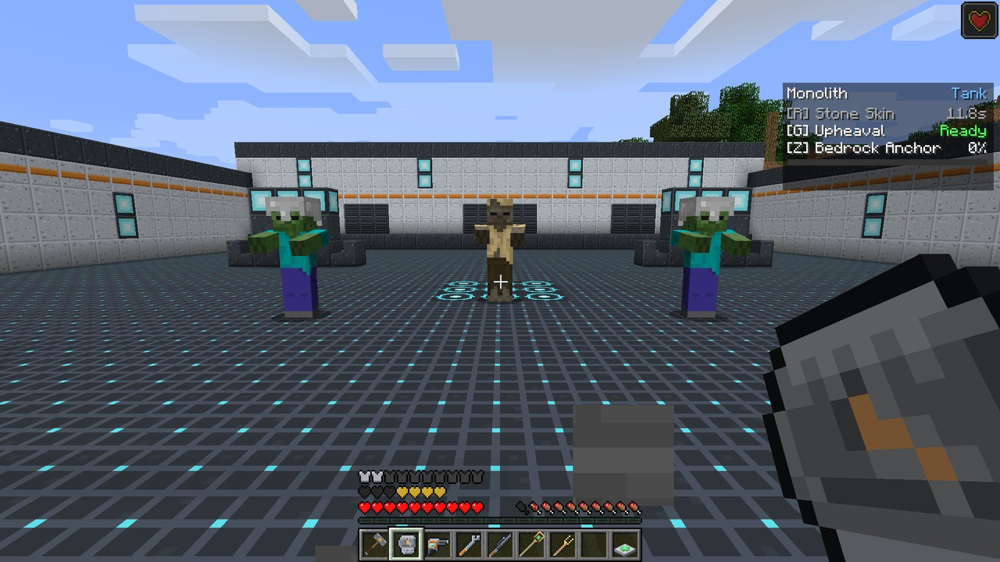

# Roles and passives

Every hero belongs to one of three roles. The role decides the **passive** you get while that hero
is active, and its colour on the HUD.

| Role | Heroes | Passive, in one line |
| --- | --- | --- |
| Tank | [Bulwark](../heroes/bulwark.md), [Monolith](../heroes/monolith.md) | Tougher: more armor, more health, less knockback |
| Damage | [Forgewright](../heroes/forgewright.md), [Kestrel](../heroes/kestrel.md) | Your hits leave enemies **Wounded**, so they heal less |
| Support | [Solace](../heroes/solace.md), [Chime](../heroes/chime.md) | You regenerate when out of combat |

## Tank

While you are a Tank you get:

| Bonus | Default |
| --- | --- |
| Armor | **+4** (two armor icons) |
| Max health | **+6** (three extra hearts) |
| Knockback resistance | **50%** |

The bonuses apply the moment you pick up the item and are removed the moment you put it down. If
you are above your normal maximum health when you stop being a Tank, your health drops to the
normal maximum.

## Damage

Every time a Damage hero hurts an **enemy**, the enemy is **Wounded** for **3 seconds**. A
Wounded creature receives only **50%** of any healing: potions, regeneration, a witch's own
potions, an enemy player's heals. The timer restarts on every hit, so steady pressure keeps a
target Wounded.

Wounded is a visible status effect, so you can see it on a player you have hit.

!!! tip "Why it matters"

    Against mobs, Wounded mostly shuts down witches and regenerating bosses. In PvP it is the
    counter to Supports: a Damage hero on the enemy frontline halves everything the enemy healer
    does.

## Support

After **3 seconds without taking damage**, a Support regenerates **0.5 health per second** (a
heart every four seconds) until full. Any damage resets the timer.

This keeps a healer topped up between fights without a separate healer of its own. It is not
healing *done*, so it does not charge the ultimate.

## Changing the numbers

All of these are in the `passives` section of `config/ldfl.cfg`:
`tankArmor`, `tankHealth`, `tankKnockbackResistance`, `damageWoundSeconds`,
`woundedHealingFactor`, `supportRegenDelaySeconds` and `supportRegenPerSecond`. See
[Configuration](../reference/config.md#passives).
