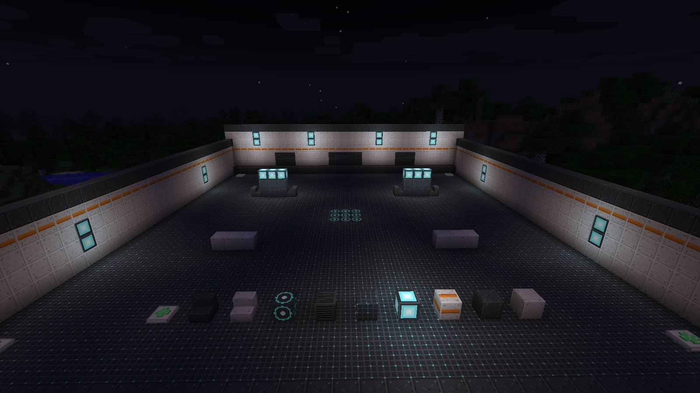

# Playing as a team

Every hero is useful alone, but the kits are built to lean on each other. This page has ideas for
groups: pairings that work, a few combos, and how to use the building set to make an arena.

## A balanced team

The classic shape is **one of each role, or two-two-two** for six players:

| Role | Job |
| --- | --- |
| Tank | Stand at the front, take the hits, control where the mobs go |
| Damage | Kill things, and keep the important targets Wounded |
| Support | Keep the Tank alive and the team strong |

With fewer players, pick the hero that fills your group's gap. A duo of Bulwark and Solace is
famously hard to kill; a duo of Forgewright and Chime hits very hard.

## Pairings that work

**Bulwark + Kestrel.** Kestrel charges shots behind the barrier, steps out, fires, steps back.
The barrier blocks the skeletons' answer.

**Monolith + Forgewright.** Anchor in front of a sentry. Every mob runs to Monolith, straight into
the sentry's line of fire.

**Solace + any Tank.** Beam the Tank, flask the crowd around it. The flask Wounds the enemies
your Tank is fighting at the same moment it heals the Tank.

**Chime + Damage heroes.** Resonance's Strength turns melee into big numbers, and Kestrel's Marker
Dart stacks on top of it: a Marked target takes 30% more from everyone.

## Ultimate combos

Ultimates are strongest together. A few that line up well:

| First | Then | Why |
| --- | --- | --- |
| Monolith's **Bedrock Anchor** | Bulwark's **Tectonic Slam** | Anchor drags every mob to one spot; the slam staggers the whole pile |
| Monolith's **Bedrock Anchor** | Chime's **Crescendo** | Monolith survives taking everyone's attention, Crescendo makes it nearly invulnerable |
| Bulwark's **Tectonic Slam** | Kestrel's **Long Vigil** | Staggered mobs stand still in a line for piercing shots |
| Kestrel's **Marker Dart** | Forgewright's **Slag Surge** | A Marked boss under a surging sentry melts |
| Any big fight | Solace's **Sanctuary** | Heals everyone at once, then keeps regenerating and protecting for six seconds |

## Make an arena

The [building set](building-set.md) is made for this: hull panels for walls and cover, grid floor,
lumen panels to light it, an objective pad for the middle, and **Mending Stations** for a healing
point that anyone can use and everyone can see.

Ideas:

- **Wave defence.** Build a room, spawn mobs at the far end with a command block or spawner, and
  hold the line. Put Mending Stations behind the line so retreating is a real choice.
- **King of the hill.** An objective pad in the middle, cover around it. With PvP on and two
  teams, the team standing on the pad when time runs out wins.
- **Training range.** Mobs with `NoAI` in a row at different distances make a firing range for
  Kestrel, or a test bed for Shockwave lines and slam cones.

## Server tips

- Leave `combat.pvp` off for co-op servers. Turn it on for an arena world or a minigame
  server, and use scoreboard teams.
- Every number is tunable, live, in `config/ldfl.cfg`. If one hero dominates on your server,
  adjust its cooldown or ult cost rather than banning it. See [Configuration](../reference/config.md).
