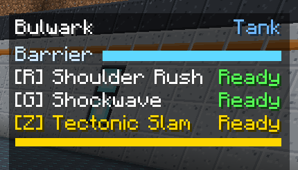

# Ultimates

Each hero's third ability is its **ultimate**: the big, fight-changing one. It has no cooldown.
It is gated by the **ultimate meter** under the HUD, which fills as you fight and empties when you
fire.

## What fills the meter

| Source | Counts for | Notes |
| --- | --- | --- |
| **Damage dealt to enemies** | Every hero | Only damage that actually lands. Overkill does not count, so one-shotting a zombie with 100 damage earns 20, its health |
| **Healing done** | Every hero (mainly Solace) | Only healing that lands. Topping up someone at full health earns nothing |
| **Support given** | Chime | 2 points per ally buffed by Resonance, 1 per ally shielded by each Ward Bell ring |

Damage to allies, to passive animals and to blocks earns nothing. Your sentry's bolts (as
Forgewright) count as your own damage. Your own Support regeneration does not count.

## How much it takes

Each hero needs a different amount to fill the meter from empty:

| Hero | Ultimate | Cost |
| --- | --- | --- |
| [Bulwark](../heroes/bulwark.md) | Tectonic Slam | 160 |
| [Monolith](../heroes/monolith.md) | Bedrock Anchor | 180 |
| [Forgewright](../heroes/forgewright.md) | Slag Surge | 200 |
| [Kestrel](../heroes/kestrel.md) | Long Vigil | 220 |
| [Solace](../heroes/solace.md) | Sanctuary | 200 |
| [Chime](../heroes/chime.md) | Crescendo | 200 |

For scale: a zombie has 20 health, so Bulwark fills its meter by dealing the equivalent of eight
zombies' worth of damage.

## When it is ready

The ultimate line on the HUD turns gold, flashes, and reads **Ready**, and you hear a short chime.
Press Z and the meter empties.

## Things that empty it

- **Switching hero.** The new hero starts with an empty meter. See
  [Switching heroes](how-heroes-work.md#switching-heroes).
- **Dying, or logging out.** Hero state is never saved.

## Operators and testing

`/ldfl ult` fills the meter of whoever runs it (or of a named player). See
[Commands](../reference/commands.md).
