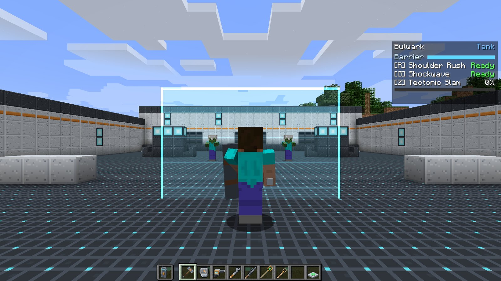
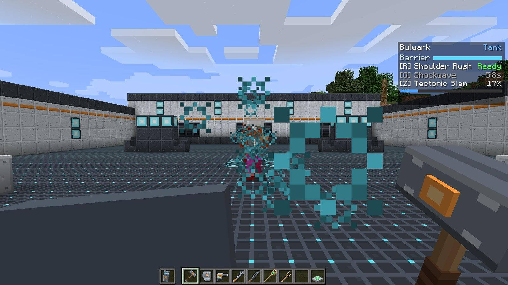
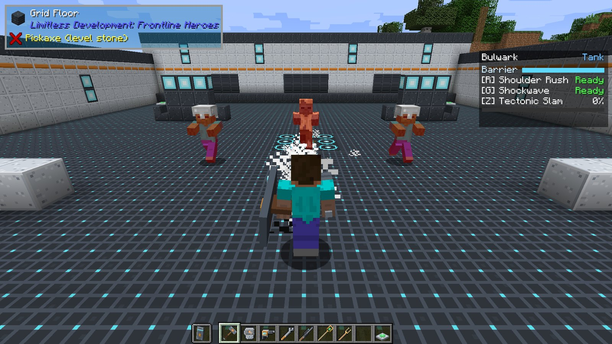

# Bulwark

<strong>Bulwark</strong>
Tank &nbsp;Shield wall and crowd control
Signature items: <strong>Bulwark Shield</strong>, <strong>Bulwark Maul</strong>

Bulwark is the classic shield tank. It carries a **barrier**: a wide, glowing panel that stops
enemy projectiles and melee for everyone standing behind it. Between barrier pushes it closes
distance with a charge, hits a whole line of enemies with a shockwave, and ends fights with a
forward ground slam that stuns everything in front of it.

## Signature items

| Item | Hand | What it does |
| --- | --- | --- |
|  **Bulwark Shield** | Off hand (best) | Hold right-click to block like a vanilla shield **and** project the barrier. Never wears out. Axes can disable it, as with a vanilla shield. |
|  **Bulwark Maul** | Main hand | A heavy two-handed hammer: **10 attack damage**, 0.9 swings per second. Never wears out. |

Either item alone makes you Bulwark. The intended loadout is **maul in the main hand, shield in
the off hand**: you swing with left-click and raise the barrier with right-click.

## Passive: Tank

Like every Tank, Bulwark gets **+4 armor**, **+6 max health** (three hearts) and **50% knockback
resistance** for as long as it is the active hero. See [Roles and passives](../guide/roles.md).

## The barrier

Hold right-click with the Bulwark Shield for a moment (a fifth of a second, so a quick tap does
nothing) and a translucent panel rises in front of you, facing where you look. It follows your
aim while you hold it.

- It **stops enemy projectiles**: arrows, thrown potions and snowballs, fireballs, and other
  heroes' bolts. Each one blocked costs the barrier roughly the damage it would have done
  (fireballs count as 8).
- It **stops enemy melee** aimed through it at you or at an ally behind it. The hit lands on the
  barrier instead.
- **Enemies cannot walk through it.** A mob that walks into the panel is pushed back out.
- **Allies are not blocked at all.** Your team can shoot, swing and walk through your barrier.

The barrier has **60 health**, shown as the **Barrier** bar on the HUD. When it is lowered it
starts regenerating after two seconds at **6 health per second**. If it is broken it shatters and
cannot be raised again for **5 seconds**.

!!! tip "Lower it to let it recover"

    The barrier only regenerates while it is down. Holding it up through a long fight drains it;
    dropping it for a few seconds behind cover tops it back up. Watch the bar colour: blue above
    half, amber below half, red under a quarter.

## Abilities

!!! ability "Shoulder Rush · R · 8 s cooldown"

    A short, fast forward dash (half a second). The first enemy you run into takes **6 damage**
    and is thrown back hard, and the dash ends there. Use it to close distance, to knock a
    mob off a ledge, or to bail out of a bad position.

!!! ability "Shockwave · G · 6 s cooldown"

    A line of force along your look direction, up to **16 blocks**. It stops at the first solid
    block, and every enemy along the line takes **5 damage** once and is pushed back a little.
    Aim it down a corridor or along a row of mobs.

    

!!! ultimate "Tectonic Slam · Z · ultimate (160 damage)"

    Slam the ground in front of you. Every enemy in a **100° cone out to 8 blocks** takes
    **6 damage**, is knocked into the air, and is left with **Slowness IV** and **Weakness II**
    for two and a half seconds. A crack of dust runs out along the cone.

    The stagger is the real payoff: for a couple of seconds the mobs in front of you can barely
    move or hurt anyone. That is the window for your team to unload.

    

## Playing Bulwark

- **Lead with the barrier.** Walk into a fight with the shield up and your Damage and Support
  heroes tucked in behind you. They can shoot through it, the enemy cannot.
- **Rush and Shockwave are your damage.** The maul hits hard but slowly; the two abilities keep
  pressure on while the barrier recovers.
- **Save the slam for a crowd.** One zombie is not worth an ultimate; a doorway full of them is.
- **Shield in the off hand, anything in the main hand.** You stay Bulwark while the shield is in
  your off hand, as long as the main hand does not hold another hero's item. See
  [How heroes work](../guide/how-heroes-work.md#which-hand-counts).

## Crafting

<!-- recipe:bulwark_shield -->

Iron IngotGlass PaneIron IngotIron IngotShieldIron IngotIron IngotDiamondIron Ingot

→

<!-- /recipe -->
<!-- recipe:bulwark_maul -->

Iron BlockIron BlockIron BlockIron BlockStickIron BlockStick

→

<!-- /recipe -->

## Tuning

Server owners can change every number on this page in `config/ldfl.cfg` under `bulwark`. See
[Configuration](../reference/config.md#bulwark).
