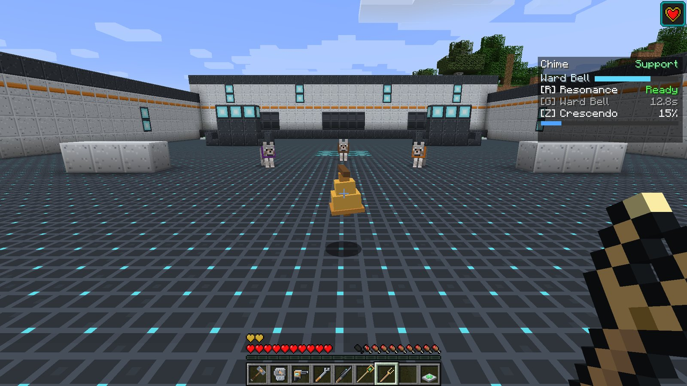
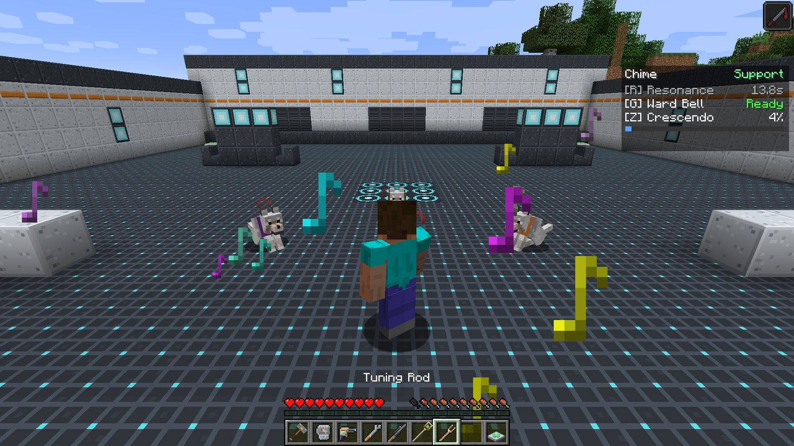
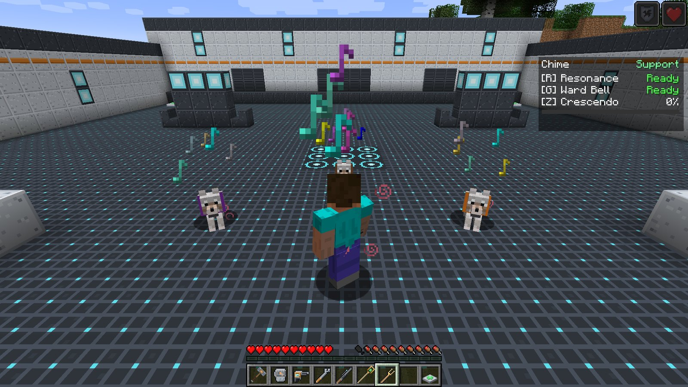

# Chime

<strong>Chime</strong>
Support &nbsp;Buffs and shields
Signature item: <strong>Tuning Rod</strong>

Chime supports with sound. Instead of healing, it makes the team **hit harder** and **soak more
damage**: a resonant chord that lends Strength, a bell that keeps shielding everyone nearby, and
an ultimate crescendo that makes the whole team nearly untouchable for a few seconds.

## Signature item

| Item | What it does |
| --- | --- |
|  **Tuning Rod** | Right-click to fire a slow **resonant orb** that flies straight (no drop) and hits for **3.5 damage**. A little under two orbs a second. Never wears out. |

## Passive: Support

After **3 seconds without taking damage**, you regenerate **0.5 health per second**. See
[Roles and passives](../guide/roles.md#support).

## Abilities

!!! ability "Resonance · R · 14 s cooldown"

    Strike a chord: you and every ally within **8 blocks** get **Strength I for 6 seconds**
    (+3 melee damage per hit). Music notes burst around you.

    

!!! ability "Ward Bell · G · 16 s cooldown"

    Set a bell down at your feet. For **10 seconds** it rings **every 2 seconds**, and each ring
    gives every ally within **6 blocks** a layer of **absorption** (two golden hearts,
    renewed on every ring). The HUD shows a **Ward Bell** bar for the time left.

    You can have one bell at a time: ringing a new one silences the old. The bell stays where you
    put it, so set it down where the team will be fighting.

!!! ultimate "Crescendo · Z · ultimate (200)"

    A huge chord. Every ally within **10 blocks**, you included, gets **Resistance IV** and
    **Regeneration II** for **3 seconds**. Resistance IV cuts incoming damage by 80%, so for those
    three seconds the team can walk through almost anything.

    

!!! note "How Chime charges its ultimate"

    Chime charges from damage dealt, like everyone, and from **support given**: each ally
    Resonance buffs counts as 2 points, and each ally a Ward Bell ring shields counts as 1. Keep
    the team buffed and the meter fills.

## Playing Chime

- **Resonance before the push.** Six seconds of Strength is worth most when your team is about to
  swing.
- **Bell in the middle of the fight, not behind it.** Absorption only reaches 6 blocks; plant it
  where your Tank is standing.
- **Crescendo to survive the moment that would kill you.** A boss slam, a creeper, a pile of mobs
  on your Tank. Three seconds is short, so call it at the last second, not early.
- The Tuning Rod's orbs are slow but they count: chip in damage between abilities.

## Crafting

<!-- recipe:tuning_rod -->

Note BlockGold IngotStickNote BlockStick

→

<!-- /recipe -->

## Tuning

Orb damage, cooldowns, Ward Bell lifetime, Crescendo length and ult cost live in
`config/ldfl.cfg` under `chime`. See [Configuration](../reference/config.md#chime).
