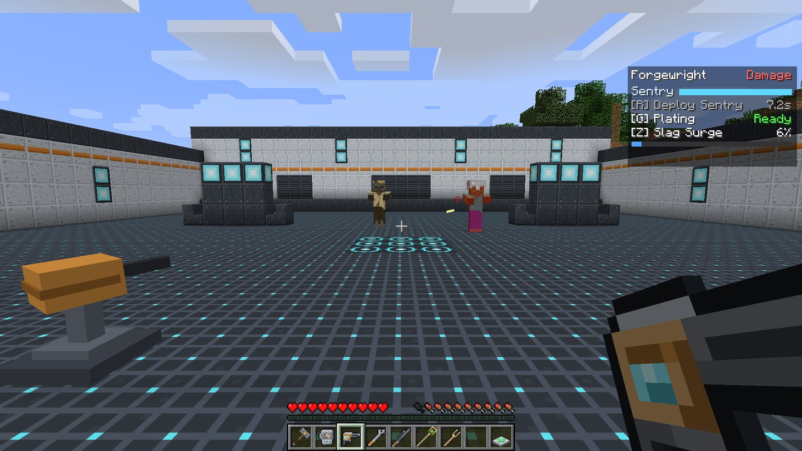
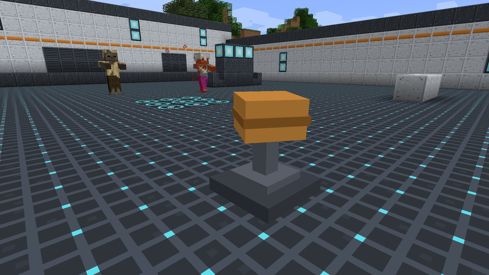

# Forgewright

<strong>Forgewright</strong>
Damage &nbsp;Engineer with an auto-turret
Signature items: <strong>Bolt Driver</strong>, <strong>Tinker's Wrench</strong>

Forgewright is a builder who brings a second gun to every fight. It drops a **sentry** that
locks on to enemies by itself, keeps it repaired with a wrench, and with its ultimate turns both
its own shots and the sentry's into fire.

## Signature items

| Item | What it does |
| --- | --- |
|  **Bolt Driver** | Right-click to fire a fast, straight **bolt** (no drop) for **4 damage**. About two and a half shots a second. No ammunition, never wears out. |
|  **Tinker's Wrench** | A melee tool: **5 attack damage**, 1.8 swings per second. Hitting **your own sentry** (or an ally's) with it **repairs 6 health** instead of hurting it. |

## Passive: Damage

Every enemy Forgewright hits, with the Bolt Driver, the wrench or the sentry, is left
**Wounded** for 3 seconds: it receives only **half** the healing it would otherwise get. See
[Roles and passives](../guide/roles.md#damage).

## The sentry

The sentry is a small turret with **30 health**. It turns to face the nearest enemy within
**16 blocks** that it can see and fires a bolt at it **twice a second**, **3 damage** each. The
HUD shows its health as a **Sentry** bar while one is out.

- You can have **one sentry at a time**. Deploying again packs the old one away.
- You and your allies **cannot damage** your sentry. Enemies, and enemy players with PvP on, can.
- It only fires while you are online **and** are Forgewright. Switch hero and it powers down;
  leave it idle for **30 seconds** and it packs itself away, so abandoned sentries never litter a
  server.
- Its bolts count as **your** shots: they charge your ultimate and leave targets Wounded.

## Abilities

!!! ability "Deploy Sentry · R · 10 s cooldown"

    Place a sentry on top of the block you are looking at, up to **6 blocks** away. It needs a
    clear, dry spot: aim at the **top face** of a block with room above it. If there is no room,
    nothing is placed and **no cooldown is spent**.

    

!!! ability "Plating · G · 12 s cooldown"

    Iron plating snaps on: **Resistance II for 5 seconds** (40% less damage), and your sentry
    is **fully repaired** wherever it is. Use it when you are under fire, or when the sentry is
    about to break.

!!! ultimate "Slag Surge · Z · ultimate (200 damage)"

    For **8 seconds** the forge runs hot:

    - your sentry fires **twice as fast** (four bolts a second),
    - your Bolt Driver hits for **1.5×** damage (6),
    - and **every bolt**, yours and the sentry's, **sets its target on fire** for 3 seconds.

    Flames trail from you while it lasts.

    

## Playing Forgewright

- **Place the sentry where you want to fight, not where you are standing.** A sentry on a
  high block, covering a doorway, wins fights on its own.
- **Repair between waves.** Swap to the wrench and give the sentry a few whacks. Plating also
  heals it fully from anywhere, so time it for the moment the sentry is in trouble.
- **The sentry is the bigger gun during Slag Surge.** Ult when the sentry has targets in front of
  it.
- Holding the **wrench** keeps you Forgewright too, so you can repair without losing your
  abilities.

## Crafting

<!-- recipe:bolt_driver -->

Iron IngotIron IngotIron IngotRedstoneBowGold IngotIron Ingot

→

<!-- /recipe -->
<!-- recipe:tinkers_wrench -->

Iron IngotRedstoneGold IngotIron IngotIron Ingot

→

<!-- /recipe -->

## Tuning

Bolt and sentry damage, sentry health, fire rate and range, cooldowns, surge length and ult cost
live in `config/ldfl.cfg` under `forgewright`. See
[Configuration](../reference/config.md#forgewright).
