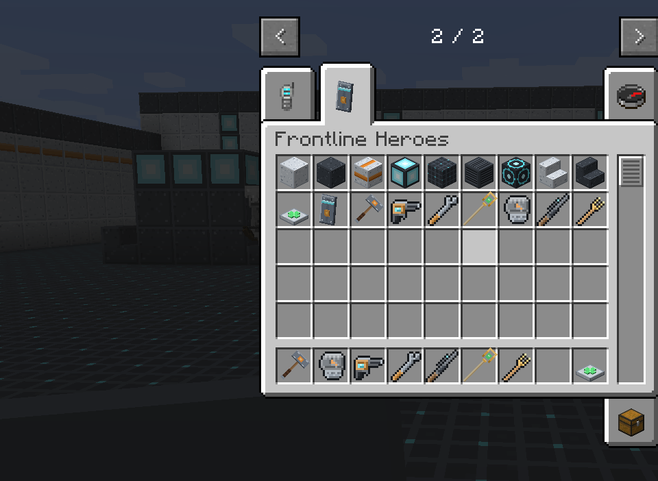
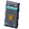
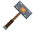
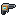
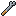
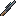
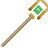

# Heroes

Six heroes, two of each role. Every hero has a **signature item** that makes you that hero, a
**role passive**, two **abilities** on cooldowns (R and
G), and an **ultimate** (Z) that charges as
you fight.

## The roster

| Hero | Role | Signature item | R | G | Z Ultimate |
| --- | --- | --- | --- | --- | --- |
| [Bulwark](bulwark.md) | Tank |  Bulwark Shield,  Bulwark Maul | Shoulder Rush | Shockwave | Tectonic Slam |
| [Monolith](monolith.md) | Tank |  Cragfist | Stone Skin | Upheaval | Bedrock Anchor |
| [Forgewright](forgewright.md) | Damage |  Bolt Driver,  Tinker's Wrench | Deploy Sentry | Plating | Slag Surge |
| [Kestrel](kestrel.md) | Damage |  Longshot Rifle | Updraft | Marker Dart | Long Vigil |
| [Solace](solace.md) | Support |  Solace Staff | Bloom Flask | Tailwind | Sanctuary |
| [Chime](chime.md) | Support |  Tuning Rod | Resonance | Ward Bell | Crescendo |

## Which hero should I pick?

!!! question "I want to protect my friends"

    **[Bulwark](bulwark.md)** if you like holding a line: the barrier is a moving wall for your
    whole team. **[Monolith](monolith.md)** if you would rather get stuck in and pull the mobs
    off everyone else.

!!! question "I want to deal damage"

    **[Forgewright](forgewright.md)** if you like setting up: the sentry fights alongside you.
    **[Kestrel](kestrel.md)** if you like precision: big, instant shots from far away.

!!! question "I want to keep the team alive"

    **[Solace](solace.md)** if you like healing directly. **[Chime](chime.md)** if you prefer
    making everyone stronger and tougher so they need less healing.

!!! tip "Swap any time"

    There is no hero select screen and no lock-in. Your hero is whatever signature item you are
    holding, so carrying two or three in your hotbar lets you switch mid-fight. The price:
    **switching hero empties your ultimate meter**, so swap before you have built up charge, not
    after. See [How heroes work](../guide/how-heroes-work.md#switching-heroes).

## At-a-glance numbers

Default values; a server can change all of them. The full list, with every radius and duration,
is on the [ability table](../reference/abilities.md).

| Hero | Weapon damage | R cooldown | G cooldown | Ultimate cost |
| --- | --- | --- | --- | --- |
| Bulwark | 10 (maul) | 8 s | 6 s | 160 damage |
| Monolith | 9 (Cragfist) | 12 s | 10 s | 180 damage |
| Forgewright | 4 per bolt, 3 per sentry bolt | 10 s | 12 s | 200 damage |
| Kestrel | 4–16 by charge | 8 s | 10 s | 220 damage |
| Solace | none (heal beam 3/s) | 8 s | 12 s | 200 healing |
| Chime | 3.5 per orb | 14 s | 16 s | 200 damage + support |
