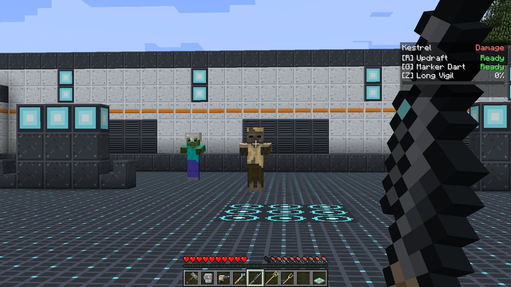
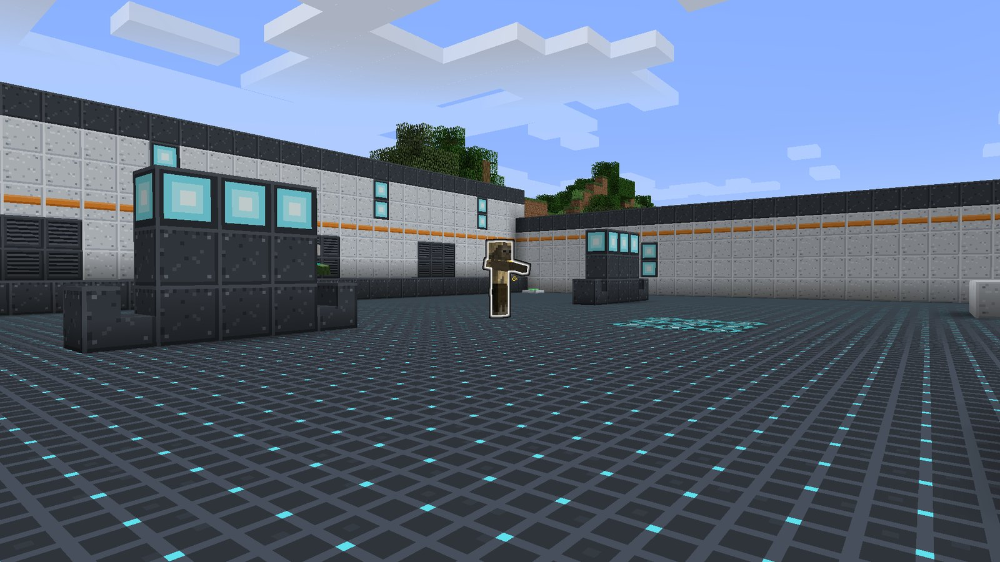
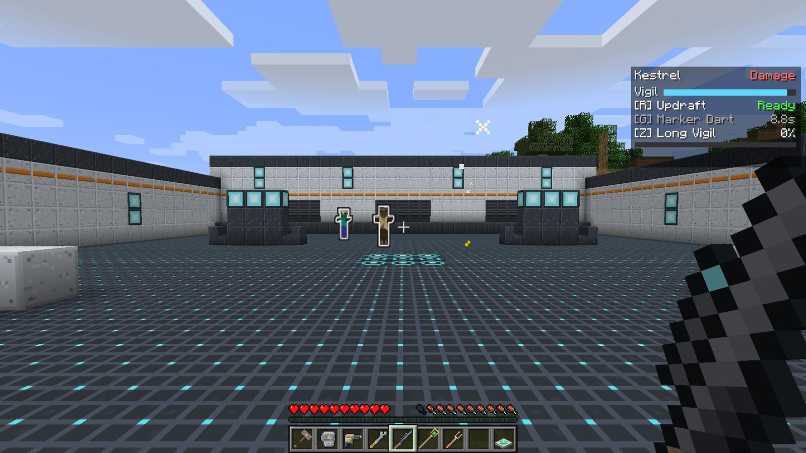

# Kestrel

<strong>Kestrel</strong>
Damage &nbsp;Long-range marksman
Signature item: <strong>Longshot Rifle</strong>

Kestrel picks fights from far away. Its rifle hits instantly and hardest when charged, it can
leap into the air and glide to a high perch, and it marks targets so the whole team hits them
harder. Its ultimate reveals every enemy around and lets each shot pass straight through a line
of them.

## Signature item

| Item | What it does |
| --- | --- |
|  **Longshot Rifle** | **Hold right-click to charge, release to fire.** The shot is instant (hitscan) out to **64 blocks** and hits the first enemy on the line. No ammunition, never wears out. |

### Charging the Longshot

Damage grows with charge, from **4** for a snap shot to **16** at full charge, which takes
**1.5 seconds**. The curve is steep at the end: a half-charged shot does about 7, so a full
charge is worth waiting for.

- The **view zooms in** as you charge, like a scope.
- A fully charged shot leaves a bright white streak; a partial one leaves a trail of crit sparks.
- After each shot the rifle needs half a second before it can charge again.

## Passive: Damage

Every enemy you hit is **Wounded** for 3 seconds and receives only **half** its healing. See
[Roles and passives](../guide/roles.md#damage).

## Abilities

!!! ability "Updraft · R · 8 s cooldown"

    A gust launches you **straight up**, about six blocks. On the way back down your **fall is
    slowed** to a glide, and you take **no fall damage** for the whole flight. Use it to reach a
    rooftop or a ledge, to get a better angle, or to escape a mob that has caught you.

!!! ability "Marker Dart · G · 10 s cooldown"

    Fire a dart along your aim, up to **48 blocks**. The first enemy it hits **glows** (visible
    through walls) and is **Marked** for **6 seconds**: it takes **30% more damage from
    everyone**, not just from you.

    

!!! ultimate "Long Vigil · Z · ultimate (220 damage)"

    For **8 seconds**:

    - every enemy within **48 blocks** **glows**, so you can see them through walls,
    - your Longshot **pierces**, hitting **every** enemy on the line instead of the first,
    - and it **charges twice as fast** (0.75 s to full).

    The HUD shows a **Vigil** bar counting down.

    

## Playing Kestrel

- **Charge before you peek.** Hold right-click behind cover, step out, release.
- **Mark the big target.** A Marked mob takes extra damage from your whole team; dart whatever
  your Tank is fighting.
- **Updraft is your escape and your perch.** The glide covers a lot of ground; you can drift
  onto a wall top and fire from there.
- **Line them up during Long Vigil.** Piercing shots reward a corridor or a column of mobs coming
  at you.

## Crafting

<!-- recipe:longshot_rifle -->

Glass PaneIron IngotBowIron IngotIron Ingot

→

<!-- /recipe -->

## Tuning

Longshot damage and charge time, Updraft and Marker Dart cooldowns, the Marked bonus and duration,
Long Vigil length and ult cost live in `config/ldfl.cfg` under `kestrel`. See
[Configuration](../reference/config.md#kestrel).
