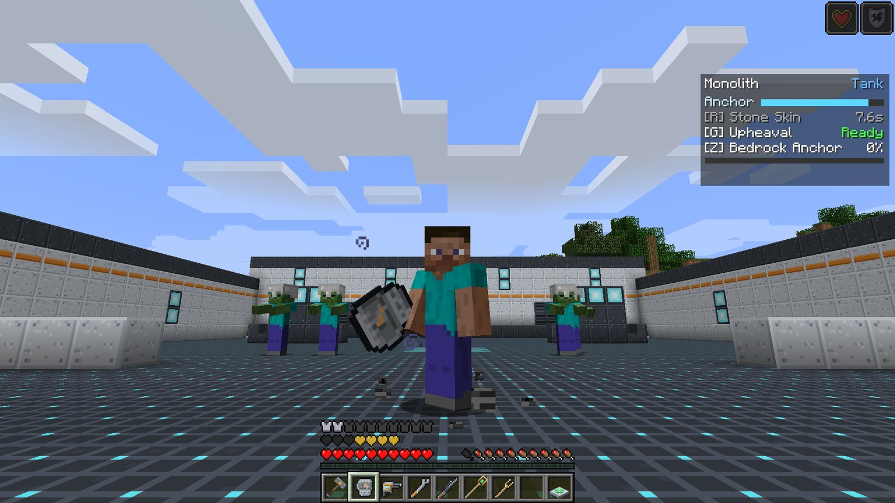
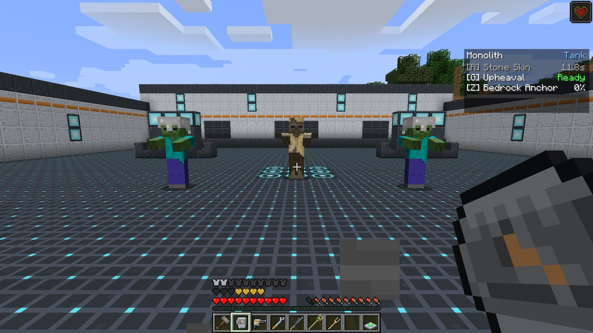
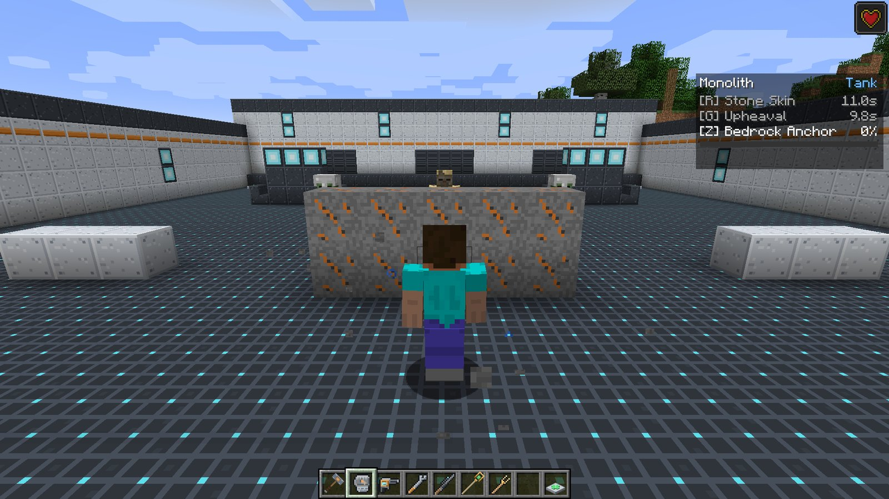

# Monolith

<strong>Monolith</strong>
Tank &nbsp;Stone walls and taunts
Signature item: <strong>Cragfist</strong>

Monolith is a brawler tank made of stone. Where [Bulwark](bulwark.md) protects with a barrier,
Monolith protects by **becoming the target**: it hardens its skin, throws up walls of rock to
block paths, and with its ultimate drags every hostile mob nearby onto itself while it stands
immovable.

## Signature item

| Item | What it does |
| --- | --- |
|  **Cragfist** | A stone-and-iron gauntlet: **9 attack damage**, 1.1 swings per second. Never wears out. |

## Passive: Tank

**+4 armor**, **+6 max health** (three hearts) and **50% knockback resistance** while Monolith is
active. See [Roles and passives](../guide/roles.md).

## Abilities

!!! ability "Stone Skin · R · 12 s cooldown"

    Your skin turns to stone: **8 points of absorption** (four golden hearts) for **6 seconds**.
    Absorption soaks up damage before your real health does, so pop it just before you walk into
    a fight, not after you are already low.

    

!!! ability "Upheaval · G · 10 s cooldown"

    Raise a wall of rough **Upheaval Stone**, **5 blocks wide and 2 high**, three blocks in
    front of you and square to where you face. It crumbles away on its own after about
    **6 seconds** and drops nothing.

    - It only fills **air and plants** (grass, flowers, snow layers and the like). It never
      replaces real blocks, water or lava, so it cannot be used to grief or to dig.
    - It will not form inside a player.
    - It steps up over a one-block rise, so the wall follows gentle terrain.
    - If there is no room for even one block, nothing happens and **no cooldown is spent**.

    Use it to plug a doorway, cut a mob off from an ally, or hide a Support who is being chased.

    

!!! ultimate "Bedrock Anchor · Z · ultimate (180 damage)"

    Root yourself for **6 seconds**:

    - you **cannot be knocked back** at all,
    - you take less damage (**Resistance I**),
    - and every hostile mob within **16 blocks** is forced to target you, **re-taunted every
      second** for the whole duration.

    The HUD shows an **Anchor** bar counting down. Bedrock dust swirls at your feet while it lasts.

    Bedrock Anchor turns the fight around: the mobs that were chasing your Support turn to you,
    and your team gets six seconds of free hits.

## Playing Monolith

- **Stone Skin, then dive.** Monolith has no barrier; absorption is its shield. Use it on the way
  in.
- **Walls are for your team, not just for you.** An Upheaval between a skeleton and your Solace
  is worth more than one in front of your own face.
- **Anchor when the mobs are spread out.** The taunt collects them; then your Damage heroes
  have one tidy target area. Pair it with [Bulwark's Tectonic Slam](bulwark.md) or
  [Chime's Crescendo](chime.md) for a big turn.
- Taunting only affects **mobs**. Players, even enemy players with PvP on, choose their own
  targets.

## Crafting

<!-- recipe:cragfist -->

StoneStoneStoneStoneIron BlockStoneIron Block

→

<!-- /recipe -->

## Tuning

Server owners can change the cooldowns, absorption, wall lifetime, anchor duration, taunt radius
and ult cost in `config/ldfl.cfg` under `monolith`. See
[Configuration](../reference/config.md#monolith).
