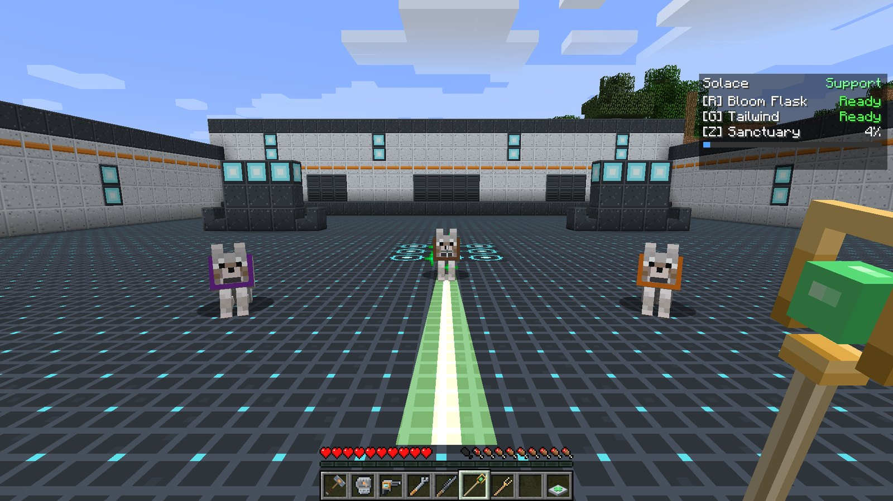
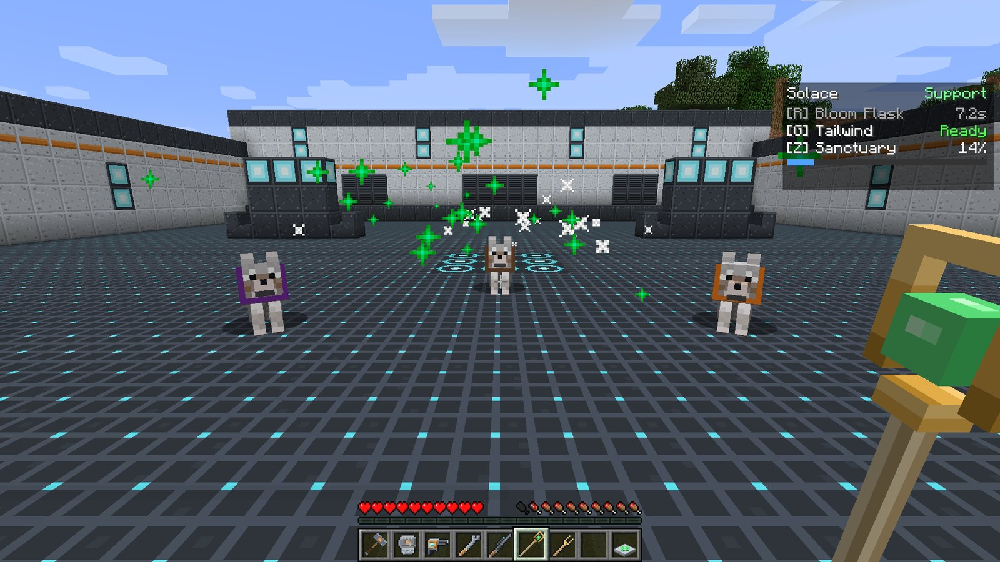
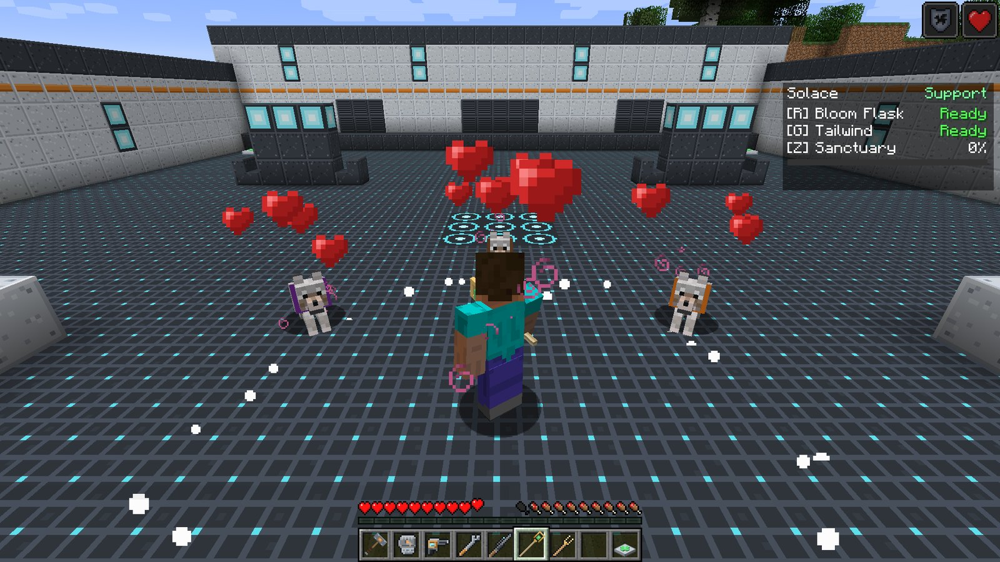

# Solace

<strong>Solace</strong>
Support &nbsp;Healer
Signature item: <strong>Solace Staff</strong>

Solace keeps the team standing. It channels a steady **heal beam** into one ally, throws flasks
that heal friends and hurt enemies in a burst, speeds the team into or out of a fight, and with
its ultimate heals and protects everyone around it at once.

## Signature item

| Item | What it does |
| --- | --- |
|  **Solace Staff** | **Hold right-click** to channel the heal beam into the ally in your sights. Never wears out. |

### The heal beam

Hold right-click with the staff and look at an ally within **12 blocks**. A beam locks on and
heals them **3 health per second** for as long as you hold it.

- Once locked, the beam **holds its target** while they stay within 15 blocks, in line of sight
  and roughly in front of you. You do not have to keep the crosshair exactly on them.
- The lock-on hitbox is generous, so it is easy to grab a moving ally.
- It **cannot target yourself**. Solace's own healing comes from the Support passive and the
  Bloom Flask.
- Only healing that actually lands counts toward your ultimate, so beaming an ally at full
  health earns nothing.

## Passive: Support

After **3 seconds without taking damage**, you regenerate **0.5 health per second**. See
[Roles and passives](../guide/roles.md#support).

## Abilities

!!! ability "Bloom Flask · R · 8 s cooldown"

    Lob a flask in an arc. Where it shatters, everything within **4 blocks** is affected:

    - **allies, you included**, are healed **6 health**,
    - **enemies** take **3 damage** and are left **Wounded** for 4 seconds.

    Throw it at your own feet in an emergency, or into the middle of a mixed fight.

    

!!! ability "Tailwind · G · 12 s cooldown"

    A gust of wind gives you and every ally within **8 blocks** **Speed II for 4 seconds**. Use it
    to get the team into position, to chase, or to retreat together.

!!! ultimate "Sanctuary · Z · ultimate (200 healing)"

    Every ally within **10 blocks**, you included, is instantly healed **10 health**, then gets
    **Regeneration II** and **Resistance I** for **6 seconds**. A ring of light spreads around you
    and hearts rise from everyone it touches.

    

!!! note "Solace charges its ultimate by healing"

    Like every hero, Solace also charges from damage it deals. But its main source is healing
    that lands, from the beam and the flask. Its own passive regeneration does **not** count.

## Playing Solace

- **Stay behind your Tank.** You are the one the mobs want. Let a [Bulwark](bulwark.md) barrier
  or a [Monolith](monolith.md) wall stand between you and them.
- **Beam the person taking damage, not the one who is merely hurt.** Steady healing on the
  frontline does more than topping up someone already safe.
- **Flask for burst.** The beam is slow and steady; the flask is the quick fix, and it Wounds
  the enemies around your ally at the same time.
- **Sanctuary when the team is low together.** It is strongest when everyone is in range.
- Allies are other players (with PvP off, every player), players on your scoreboard team, and
  **your own tamed pets**. See [Allies, enemies and PvP](../guide/allies-and-enemies.md).

## Crafting

<!-- recipe:solace_staff -->

Gold IngotEmeraldStickGold IngotStick

→

<!-- /recipe -->

## Tuning

Beam, flask and Sanctuary healing, flask damage, cooldowns and ult cost live in
`config/ldfl.cfg` under `solace`. See [Configuration](../reference/config.md#solace).
