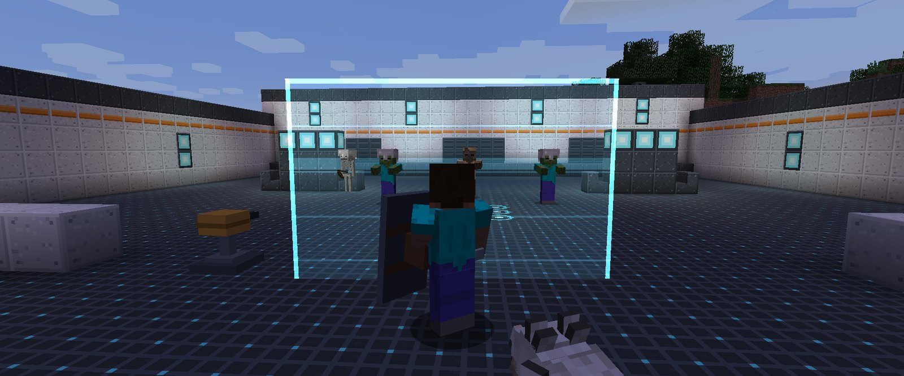
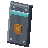
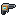
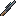
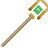
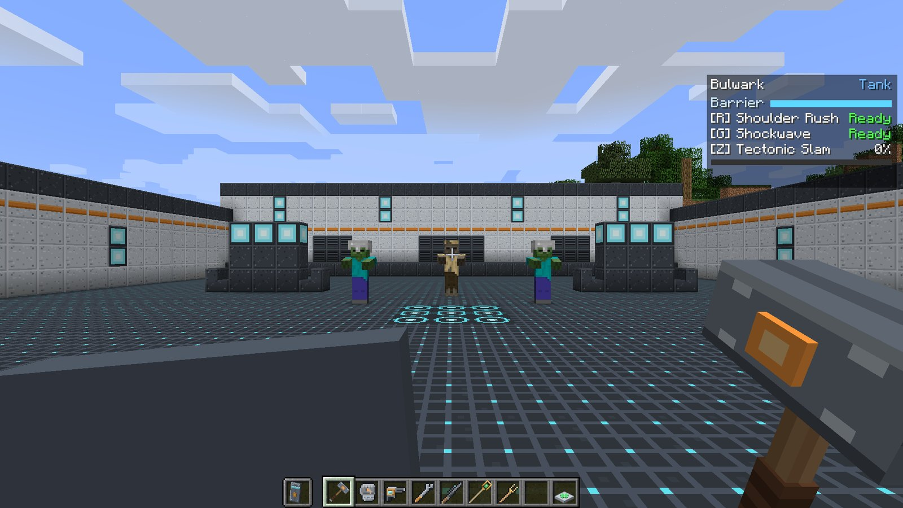

---
hide:
  - navigation
---

# Frontline Heroes

<strong>Hold the item. Become the hero.</strong>A hero-shooter inspired mod for Minecraft 1.12.2 (Forge)

**Limitless Development: Frontline Heroes** (LDFL) adds a hero system to Minecraft. Pick up a
hero's **signature item** and you *are* that hero: you get your role's passive bonus, two
abilities on cooldowns, and an **ultimate** that charges as you fight. Put the item away and you
are an ordinary player again.

There are **six heroes** across three roles, a set of futuristic **decor blocks** to build arenas
with, and a **Mending Station** pad that patches up anyone who steps on it.

-    **[Bulwark](heroes/bulwark.md)** Tank

    ---

    Raises a **barrier** that stops enemy shots and swings, charges in, and slams the ground to
    stagger everything in front of it.

-    **[Monolith](heroes/monolith.md)** Tank

    ---

    Hardens into stone, raises **rock walls**, and anchors itself to drag every mob nearby onto
    itself.

-    **[Forgewright](heroes/forgewright.md)** Damage

    ---

    Deploys an **auto-targeting sentry**, repairs it with a wrench, and sets everything alight
    with Slag Surge.

-    **[Kestrel](heroes/kestrel.md)** Damage

    ---

    A **charge-up sniper** that glides from high ground, marks targets for the team, and fires
    piercing shots.

-    **[Solace](heroes/solace.md)** Support

    ---

    Channels a **heal beam**, throws flasks that heal friends and hurt foes, and heals the whole
    team at once.

-    **[Chime](heroes/chime.md)** Support

    ---

    Buffs with **Strength**, rings a bell that keeps shielding allies, and makes the team nearly
    invulnerable.

## New here? Start with these

1. **[Install LDFL](start/installing.md)**: one jar in your `mods` folder, on client and server.
2. **[Your first hero](start/first-hero.md)**: grab a signature item and try every ability in
   five minutes.
3. **[The hero HUD](start/hud.md)**: what the panel in the top right of your screen is telling
   you.

Then read **[How heroes work](guide/how-heroes-work.md)** for the rules behind it all, or jump
straight to a hero from the cards above.

## At a glance

| | |
| --- | --- |
| **Minecraft** | 1.12.2, Forge |
| **Side** | Client **and** server (both need the jar) |
| **Default keys** | R ability 1, G ability 2, Z ultimate. Rebind under *Controls → Frontline Heroes* |
| **Heroes** | 6: two Tanks, two Damage, two Supports |
| **Survival friendly** | Every item and block is craftable, and unlocks in the recipe book as you go |
| **PvP** | Off by default: heroes fight mobs and help every player. One config switch turns it on, with scoreboard teams respected |
| **License** | [MIT](https://github.com/Mica-Technologies/LDFL/blob/main/LICENSE) |

!!! info "Original work"

    LDFL is *inspired by* the hero-shooter genre. Every hero, ability, item, texture, model and
    sound in it is original, and it is not affiliated with any game studio.

## Contributing to this wiki

Every page is a Markdown file under
[`docs/`](https://github.com/Mica-Technologies/LDFL/tree/main/docs) in the mod's repository, so a
correction is an ordinary pull request, and the site rebuilds itself when it is merged. The
:material-pencil: icon at the top of each page opens it on GitHub.
