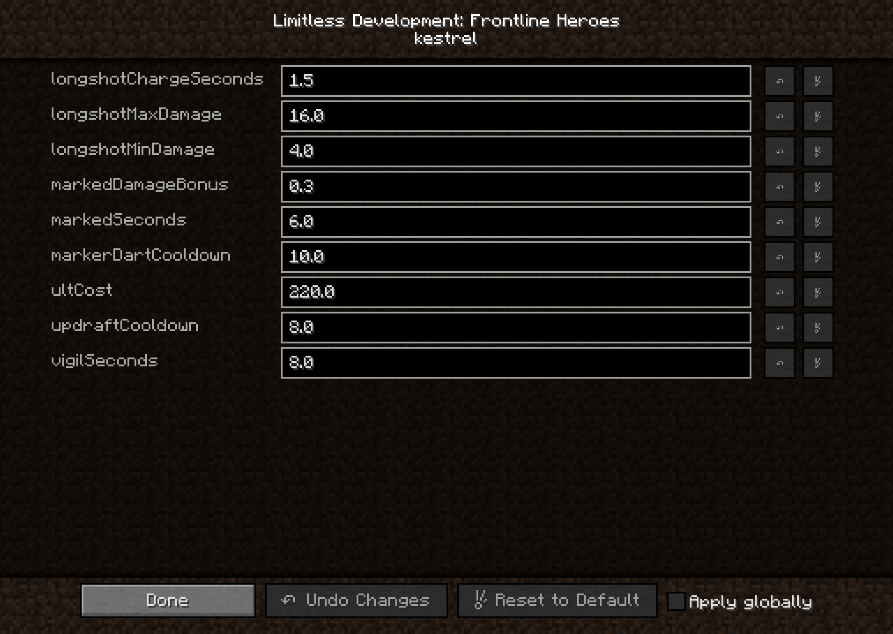

# Configuration

LDFL's settings live in **`config/ldfl.cfg`**, written the first time the game or server starts.
On a server, the server's file is the one that counts: the server runs all the combat, so clients
never need matching settings.

You can edit the file by hand, or in game through **Mods → Limitless Development: Frontline
Heroes → Config** in singleplayer.



!!! tip "Changes apply live"

    Every value is read at the moment it is used, so a change made through the config screen
    applies immediately, without a restart. The one exception is the **sentry's max health**,
    which applies to sentries deployed after the change.

Every section sits inside a `general { … }` block in the file; the section names below are the
blocks inside it.

Cooldowns and durations are in **seconds**. Damage and healing are in **health points**
(2 = one heart). Ultimate costs are the damage dealt (or healing done) that fills the meter from
empty.

## combat

| Option | Default | Range | What it does |
| --- | --- | --- | --- |
| `pvp` | `false` | true / false | When true, hero abilities and turrets also affect players. Players on the same scoreboard team are never targeted. When false (default), kits only affect hostile mobs, and every player counts as an ally. |

## passives

| Option | Default | Range | What it does |
| --- | --- | --- | --- |
| `tankArmor` | `4.0` | 0 – 30 | Tank: bonus armor points. |
| `tankHealth` | `6.0` | 0 – 40 | Tank: bonus max health (2 = one heart). |
| `tankKnockbackResistance` | `0.5` | 0 – 1 | Tank: knockback resistance (0 to 1). |
| `damageWoundSeconds` | `3` | 0 – 30 | Damage: seconds a hit leaves the target Wounded. |
| `woundedHealingFactor` | `0.5` | 0 – 1 | Fraction of healing a Wounded target still receives. |
| `supportRegenDelaySeconds` | `3` | 0 – 60 | Support: seconds without taking damage before regen starts. |
| `supportRegenPerSecond` | `0.5` | 0 – 10 | Support: health regenerated per second once regen has started. |

## bulwark

| Option | Default | Range | What it does |
| --- | --- | --- | --- |
| `shoulderRushCooldown` | `8.0` | 0 – 120 | Shoulder Rush cooldown, seconds. |
| `shoulderRushDamage` | `6.0` | 0 – 100 | Shoulder Rush damage to the enemy it hits. |
| `shockwaveCooldown` | `6.0` | 0 – 120 | Shockwave cooldown, seconds. |
| `shockwaveDamage` | `5.0` | 0 – 100 | Shockwave damage to each enemy along the line. |
| `tectonicSlamDamage` | `6.0` | 0 – 100 | Tectonic Slam (ultimate) damage to each enemy in the cone. |
| `ultCost` | `160.0` | 1 – 10000 | Damage dealt to fill the ultimate meter. |
| `barrierHealth` | `60.0` | 1 – 1000 | Barrier health. |
| `barrierRegenPerSecond` | `6.0` | 0 – 1000 | Barrier health regenerated per second while lowered. |
| `barrierBrokenSeconds` | `5.0` | 0 – 120 | Seconds a broken barrier cannot be raised. |

## monolith

| Option | Default | Range | What it does |
| --- | --- | --- | --- |
| `stoneSkinCooldown` | `12.0` | 0 – 120 | Stone Skin cooldown, seconds. |
| `stoneSkinAbsorption` | `8` | 0 – 40 | Stone Skin absorption, in health points (2 = one heart). |
| `upheavalCooldown` | `10.0` | 0 – 120 | Upheaval cooldown, seconds. |
| `upheavalSeconds` | `6.0` | 1 – 60 | Seconds an Upheaval wall stands before crumbling. |
| `anchorSeconds` | `6.0` | 1 – 60 | Bedrock Anchor (ultimate) duration, seconds. |
| `tauntRadius` | `16.0` | 1 – 48 | Radius, in blocks, in which Bedrock Anchor taunts hostile mobs. |
| `ultCost` | `180.0` | 1 – 10000 | Damage dealt to fill the ultimate meter. |

## forgewright

| Option | Default | Range | What it does |
| --- | --- | --- | --- |
| `deploySentryCooldown` | `10.0` | 0 – 120 | Deploy Sentry cooldown, seconds. |
| `platingCooldown` | `12.0` | 0 – 120 | Plating cooldown, seconds. |
| `ultCost` | `200.0` | 1 – 10000 | Damage dealt to fill the ultimate meter. |
| `slagSurgeSeconds` | `8.0` | 1 – 60 | Slag Surge (ultimate) duration, seconds. |
| `boltDamage` | `4.0` | 0 – 100 | Bolt Driver damage per bolt (1.5x during Slag Surge). |
| `sentryHealth` | `30.0` | 1 – 1000 | Sentry max health. Applies to sentries deployed after a change. |
| `sentryBoltDamage` | `3.0` | 0 – 100 | Sentry damage per bolt. |
| `sentryFireIntervalTicks` | `10` | 1 – 200 | Ticks between sentry shots (halved during Slag Surge). 20 ticks = 1 second. |
| `sentryRange` | `16.0` | 2 – 64 | Sentry targeting range, blocks. |

## kestrel

| Option | Default | Range | What it does |
| --- | --- | --- | --- |
| `longshotMinDamage` | `4.0` | 0 – 100 | Longshot damage at no charge. |
| `longshotMaxDamage` | `16.0` | 0 – 200 | Longshot damage at full charge. |
| `longshotChargeSeconds` | `1.5` | 0.1 – 10 | Seconds to fully charge a Longshot (halved during Long Vigil). |
| `updraftCooldown` | `8.0` | 0 – 120 | Updraft cooldown, seconds. |
| `markerDartCooldown` | `10.0` | 0 – 120 | Marker Dart cooldown, seconds. |
| `markedSeconds` | `6.0` | 1 – 60 | Seconds a Marker Dart leaves its target marked. |
| `markedDamageBonus` | `0.3` | 0 – 5 | Extra damage a Marked target takes (0.3 = +30%). |
| `vigilSeconds` | `8.0` | 1 – 60 | Long Vigil (ultimate) duration, seconds. |
| `ultCost` | `220.0` | 1 – 10000 | Damage dealt to fill the ultimate meter. |

## solace

| Option | Default | Range | What it does |
| --- | --- | --- | --- |
| `bloomFlaskCooldown` | `8.0` | 0 – 120 | Bloom Flask cooldown, seconds. |
| `bloomFlaskHeal` | `6.0` | 0 – 100 | Bloom Flask healing to each ally in the burst. |
| `bloomFlaskDamage` | `3.0` | 0 – 100 | Bloom Flask damage to each enemy in the burst. |
| `tailwindCooldown` | `12.0` | 0 – 120 | Tailwind cooldown, seconds. |
| `beamHealPerSecond` | `3.0` | 0 – 100 | Heal beam healing per second. |
| `sanctuaryHeal` | `10.0` | 0 – 100 | Sanctuary (ultimate) instant healing to each ally. |
| `ultCost` | `200.0` | 1 – 10000 | Healing done to fill the ultimate meter. |

## chime

| Option | Default | Range | What it does |
| --- | --- | --- | --- |
| `orbDamage` | `3.5` | 0 – 100 | Tuning Rod orb damage. |
| `resonanceCooldown` | `14.0` | 0 – 120 | Resonance cooldown, seconds. |
| `wardBellCooldown` | `16.0` | 0 – 120 | Ward Bell cooldown, seconds. |
| `wardBellSeconds` | `10.0` | 1 – 60 | Seconds a Ward Bell rings before it fades. |
| `crescendoSeconds` | `3.0` | 1 – 30 | Crescendo (ultimate) duration, seconds. |
| `ultCost` | `200.0` | 1 – 10000 | Damage dealt plus support given to fill the ultimate meter. |

## Example: a PvP arena server

```
general {
    combat {
        B:pvp=true
    }
}
```

Then put players on scoreboard teams; see [Allies, enemies and PvP](../guide/allies-and-enemies.md).

## Example: faster ultimates for a short minigame

Lower every hero's `ultCost`, for example to half:

```
general {
    bulwark {
        D:ultCost=80.0
    }
    kestrel {
        D:ultCost=110.0
    }
}
```

!!! note "Leftover keys"

    Forge keeps unknown keys in the file. If you used an early pre-release, your `ldfl.cfg` may
    still contain an option that has since been renamed; it does nothing and can be deleted.
