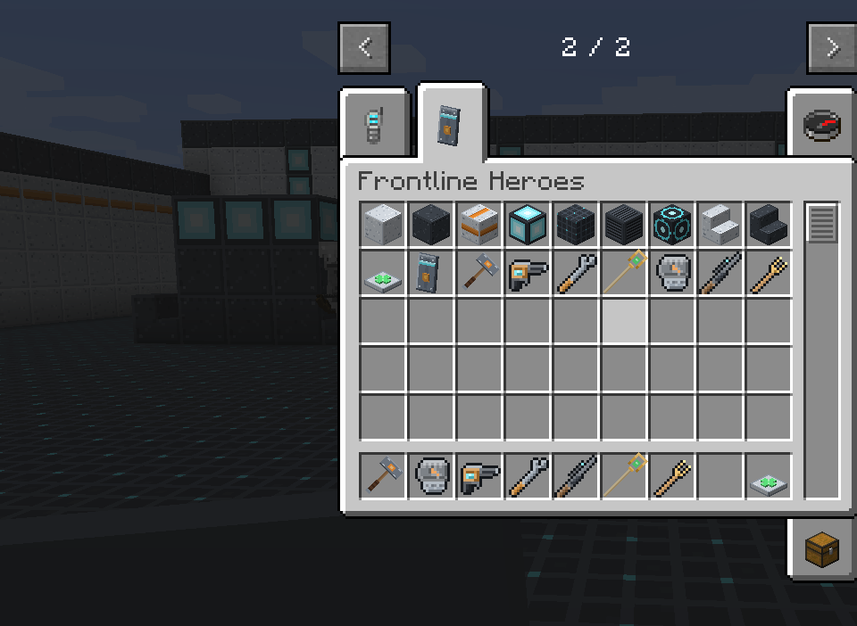

# Items and recipes

Every LDFL item and block, its registry id, and its crafting recipe. All of them are in the
**Frontline Heroes** creative tab, and every recipe **unlocks in the recipe book** as soon as you
pick up its key ingredient.

## Signature items

None of the signature items has durability; they never wear out or break.

| | Item | Id | Hero | Weapon stats |
| --- | --- | --- | --- | --- |
|  | Bulwark Shield | `ldfl:bulwark_shield` | [Bulwark](../heroes/bulwark.md) | Blocks like a shield, projects the barrier |
|  | Bulwark Maul | `ldfl:bulwark_maul` | [Bulwark](../heroes/bulwark.md) | 10 damage, 0.9 attacks/s |
|  | Cragfist | `ldfl:cragfist` | [Monolith](../heroes/monolith.md) | 9 damage, 1.1 attacks/s |
|  | Bolt Driver | `ldfl:bolt_driver` | [Forgewright](../heroes/forgewright.md) | Bolts, 4 damage, 2.5 shots/s |
|  | Tinker's Wrench | `ldfl:tinkers_wrench` | [Forgewright](../heroes/forgewright.md) | 5 damage, 1.8 attacks/s; repairs sentries |
|  | Longshot Rifle | `ldfl:longshot_rifle` | [Kestrel](../heroes/kestrel.md) | Hitscan, 4–16 damage by charge |
|  | Solace Staff | `ldfl:solace_staff` | [Solace](../heroes/solace.md) | Heal beam, 3 health/s |
|  | Tuning Rod | `ldfl:tuning_rod` | [Chime](../heroes/chime.md) | Orbs, 3.5 damage, about 1.7 shots/s |

### Recipes

=== "Bulwark Shield"

    <!-- recipe:bulwark_shield -->
    

    
Iron IngotGlass PaneIron IngotIron IngotShieldIron IngotIron IngotDiamondIron Ingot

    →
    
    

    <!-- /recipe -->

    Unlocks when you pick up a **Shield**.

=== "Bulwark Maul"

    <!-- recipe:bulwark_maul -->
    

    
Iron BlockIron BlockIron BlockIron BlockStickIron BlockStick

    →
    
    

    <!-- /recipe -->

    Unlocks when you pick up an **Iron Block**.

=== "Cragfist"

    <!-- recipe:cragfist -->
    

    
StoneStoneStoneStoneIron BlockStoneIron Block

    →
    
    

    <!-- /recipe -->

    Unlocks when you pick up an **Iron Block**.

=== "Bolt Driver"

    <!-- recipe:bolt_driver -->
    

    
Iron IngotIron IngotIron IngotRedstoneBowGold IngotIron Ingot

    →
    
    

    <!-- /recipe -->

    Unlocks when you pick up a **Bow**.

=== "Tinker's Wrench"

    <!-- recipe:tinkers_wrench -->
    

    
Iron IngotRedstoneGold IngotIron IngotIron Ingot

    →
    
    

    <!-- /recipe -->

    Unlocks when you pick up an **Iron Ingot**.

=== "Longshot Rifle"

    <!-- recipe:longshot_rifle -->
    

    
Glass PaneIron IngotBowIron IngotIron Ingot

    →
    
    

    <!-- /recipe -->

    Unlocks when you pick up a **Bow**.

=== "Solace Staff"

    <!-- recipe:solace_staff -->
    

    
Gold IngotEmeraldStickGold IngotStick

    →
    
    

    <!-- /recipe -->

    Unlocks when you pick up an **Emerald**.

=== "Tuning Rod"

    <!-- recipe:tuning_rod -->
    

    
Note BlockGold IngotStickNote BlockStick

    →
    
    

    <!-- /recipe -->

    Unlocks when you pick up a **Note Block**.

## Blocks

| | Block | Id | Recipe yield | Unlocks with |
| --- | --- | --- | --- | --- |
|  | Light Hull Panel | `ldfl:hull_panel_light` | 8 | Iron Ingot |
|  | Dark Hull Panel | `ldfl:hull_panel_dark` | 8 | Light Hull Panel |
|  | Accent Hull Panel | `ldfl:hull_panel_accent` | 8 | Light Hull Panel |
|  | Light Hull Panel Stairs | `ldfl:hull_panel_light_stairs` | 4 | Light Hull Panel |
|  | Dark Hull Panel Stairs | `ldfl:hull_panel_dark_stairs` | 4 | Dark Hull Panel |
|  | Lumen Panel | `ldfl:lumen_panel` | 4 | Glowstone |
|  | Grid Floor | `ldfl:grid_floor` | 4 | Dark Hull Panel |
|  | Vent Panel | `ldfl:vent_panel` | 4 | Dark Hull Panel |
|  | Objective Pad | `ldfl:objective_pad` | 4 | Lumen Panel |
|  | Mending Station | `ldfl:mending_station` | 1 | Glistering Melon |

### Recipes

=== "Hull panels"

    <!-- recipe:hull_panel_light -->
    

    
StoneStoneStoneStoneIron IngotStoneStoneStoneStone

    →
    8
    

    <!-- /recipe -->
    <!-- recipe:hull_panel_dark -->
    

    
Coal

    →
    8
    

    <!-- /recipe -->
    <!-- recipe:hull_panel_accent -->
    

    
Orange Dye

    →
    8
    

    <!-- /recipe -->

=== "Stairs"

    <!-- recipe:hull_panel_light_stairs -->
    

    

    →
    4
    

    <!-- /recipe -->
    <!-- recipe:hull_panel_dark_stairs -->
    

    

    →
    4
    

    <!-- /recipe -->

=== "Lights and floors"

    <!-- recipe:lumen_panel -->
    

    
Glowstone

    →
    4
    

    <!-- /recipe -->
    <!-- recipe:grid_floor -->
    

    

    →
    4
    

    <!-- /recipe -->
    <!-- recipe:vent_panel -->
    

    
Iron Bars

    →
    4
    

    <!-- /recipe -->
    <!-- recipe:objective_pad -->
    

    

    →
    4
    

    <!-- /recipe -->

=== "Mending Station"

    <!-- recipe:mending_station -->
    

    
RedstoneGlistering MelonRedstone

    →
    
    

    <!-- /recipe -->

## Technical blocks and entities

These exist in the game but are not obtainable as items:

| Name | Id | What it is |
| --- | --- | --- |
| Upheaval Stone | `ldfl:upheaval_stone` | The temporary wall Monolith's Upheaval raises. Crumbles on its own, drops nothing |
| Barrier | `ldfl:barrier` | Bulwark's barrier panel |
| Sentry | `ldfl:sentry` | Forgewright's turret |
| Bolt | `ldfl:bolt` | Bolts from the Bolt Driver and the sentry, and the Tuning Rod's orbs |
| Heal Beam | `ldfl:heal_beam` | Solace's beam |
| Bloom Flask | `ldfl:bloom_flask` | Solace's thrown flask |
| Ward Bell | `ldfl:ward_bell` | Chime's bell |
