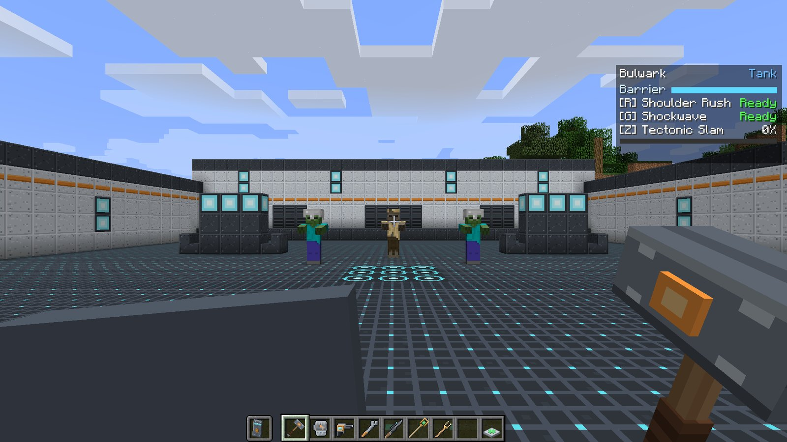
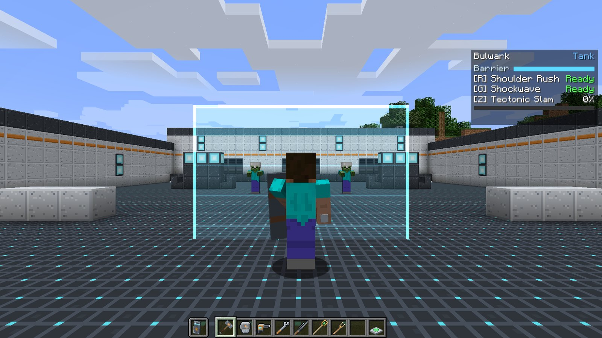
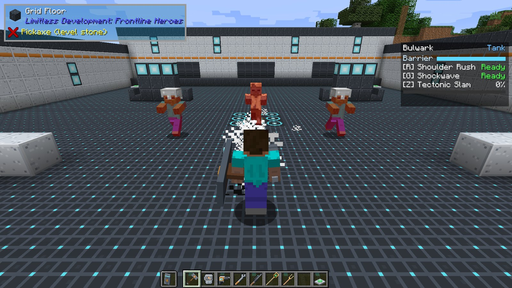

# Your first hero

Five minutes, one creative world, every part of the hero system. We will use
**[Bulwark](../heroes/bulwark.md)**, the shield tank, because it shows off every piece: a passive,
a held mechanic, two abilities and an ultimate.

## 1. Set up a test world

Create a **creative** world with **cheats on**. A superflat world is easiest.

Turn on the **difficulty** (Easy is fine). Abilities only hurt *enemies*, and on Peaceful there
are none.

## 2. Get the items

Open the creative inventory and find the **Frontline Heroes** tab. Take the
 **Bulwark Maul** and the
 **Bulwark Shield**.

Or with commands:

```
/give @p ldfl:bulwark_maul
/give @p ldfl:bulwark_shield
```

## 3. Become Bulwark

Put the **maul** in your hotbar and select it, and put the **shield** in your **off hand**
(press ++f++ with it selected to swap it there).

The moment a signature item is in your hand, the **hero HUD** appears in the top right of the
screen: your hero's name and role, your abilities with their keys, and the ultimate meter. You
are now Bulwark, and you got the Tank passive: look at your armor bar and your hearts.



Select an empty hotbar slot. The HUD disappears and the bonus hearts go away: you are an ordinary
player again. That is the whole hero system: **what you hold is who you are.**

## 4. Raise the barrier

Select the maul again and **hold right-click**. The shield comes up, and a translucent barrier
panel rises in front of you. It follows your aim. Enemy arrows and swings stop at it; your own
team can walk and shoot straight through.



Let go and it drops. The **Barrier** bar on the HUD shows its health.

## 5. Summon something to fight

```
/summon zombie ~ ~ ~5
```

Turn to face it.

## 6. Use your abilities

| Key | Ability | What to try |
| --- | --- | --- |
| <span class="slot">R</span> | **Shoulder Rush** | Look at the zombie and press ++r++. You dash forward and knock it flying. |
| <span class="slot">G</span> | **Shockwave** | Press ++g++. A line of force runs out in front of you and hits it. |

Each ability turns grey on the HUD with a countdown, and shows **Ready** in green when it is back.

## 7. Charge and fire the ultimate

Hit the zombie a few times (or summon a few more). Every point of damage you deal fills the
ultimate meter under the HUD. When it is full, the label flashes **gold**, you hear a chime, and
the line reads **Ready**.

Short on patience? An operator can fill it instantly:

```
/ldfl ult
```

Now face the mobs and press <span class="slot ult">Z</span>: **Tectonic Slam** cracks the ground in
a cone in front of you, throws the mobs up and leaves them staggered.



## 8. Try the others

Every hero works the same way: hold the item, use ++r++, ++g++ and ++z++. A quick tour:

```
/give @p ldfl:cragfist         Monolith (Tank)
/give @p ldfl:bolt_driver      Forgewright (Damage)
/give @p ldfl:longshot_rifle   Kestrel (Damage)
/give @p ldfl:solace_staff     Solace (Support)
/give @p ldfl:tuning_rod       Chime (Support)
```

Support heroes need someone to help. Tame a wolf (they count as your allies), or bring a friend.

## Where next

- **[The hero HUD](hud.md)** explains every part of the panel.
- **[How heroes work](../guide/how-heroes-work.md)** covers which hand counts, switching heroes,
  and how the server decides what happens.
- **[Heroes](../heroes/index.md)** has a full page for each of the six.
- **[Keys](hud.md#keys)** can be rebound if R, G or Z clash with another mod.
