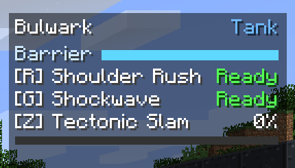
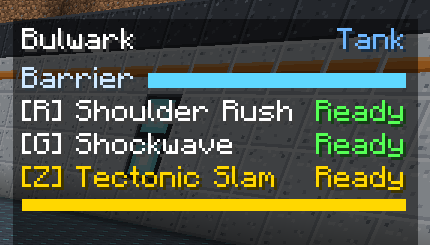

# The hero HUD

While you are a hero, a panel in the **top right** of the screen shows everything about your
current hero. It is drawn below the vanilla status-effect icons, so potion effects never cover it,
and it hides with the rest of the HUD when you press ++f1++.

## Reading it

From top to bottom:

**Hero and role**
:   Your hero's name on the left, its role on the right in the role's colour:
    Tank blue, Damage red,
    Support green.

**Resource bar** (some heroes)
:   A bar for whatever the hero is keeping alive. It is blue above half, amber below half and red
    under a quarter.

    | Hero | Bar | Shows |
    | --- | --- | --- |
    | Bulwark | **Barrier** | The barrier's health |
    | Monolith | **Anchor** | Time left on Bedrock Anchor (only while it is active) |
    | Forgewright | **Sentry** | Your sentry's health (only while one is deployed) |
    | Kestrel | **Vigil** | Time left on Long Vigil (only while it is active) |
    | Chime | **Ward Bell** | Time left on your bell (only while one is ringing) |

    Solace has no bar.

**Abilities**
:   One line each for R and G: the key in
    brackets, the ability name, and either **Ready** in green or the seconds left on its cooldown
    in grey.

**Ultimate**
:   The Z line shows your ultimate's name and how full the meter is,
    with a bar under it. When it reaches 100% the line flashes **gold and white**, reads
    **Ready**, and you hear a short chime.

## When it updates

The server owns the real numbers; the HUD is a mirror of them. Cooldowns tick down smoothly on your
side between updates, and the server corrects the mirror every couple of seconds and whenever
anything changes. If you press a key while an ability is still cooling down, nothing happens and
the HUD is simply re-synced.

## Keys

| Default key | Action | Binding name |
| --- | --- | --- |
| ++r++ | Ability 1 | *Hero Ability 1* |
| ++g++ | Ability 2 | *Hero Ability 2* |
| ++z++ | Ultimate | *Hero Ultimate* |

Rebind them under **Options → Controls**, in the **Frontline Heroes** category. The HUD always
shows whatever key you have bound.

!!! tip "Key clashes"

    ++r++, ++g++ and ++z++ are free in vanilla, but other mods sometimes use them (++r++ is a
    common "recipe" key in item-list mods). If a key does two things, Minecraft shows it in red on
    the Controls screen. Rebind one of them.

## Subtitles

Every ability has its own sound and its own subtitle, so with **Options → Music & Sounds →
Show Subtitles** on you can follow a fight by ear too. See
[Sounds and subtitles](../reference/sounds.md).
