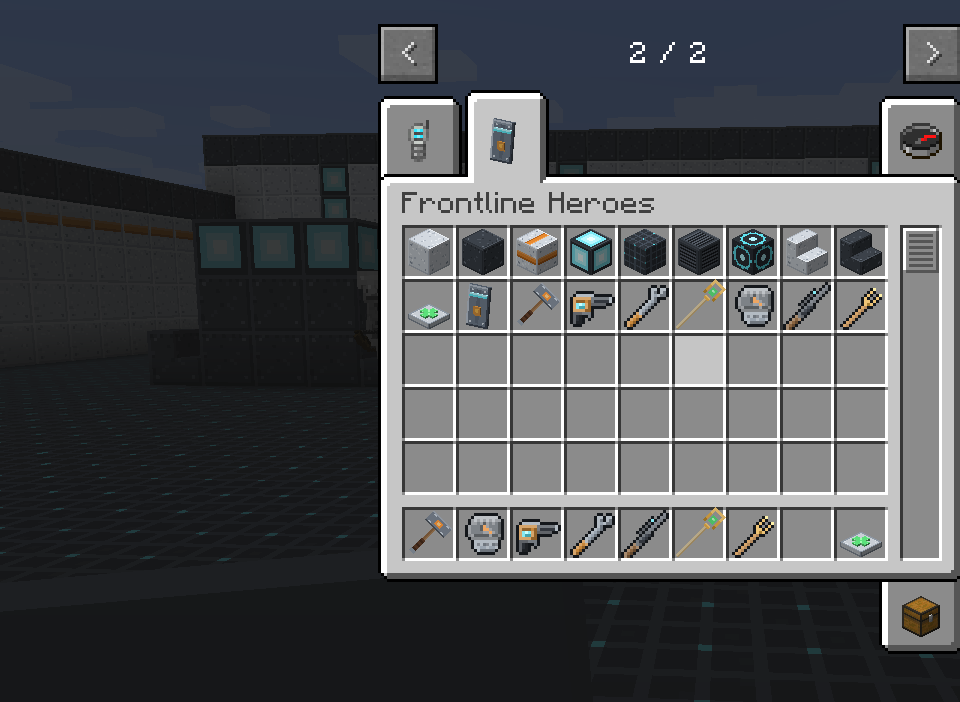

# Installing

LDFL is a single mod jar for **Minecraft 1.12.2** with **Forge**. It has no other mod
dependencies.

## Requirements

| | |
| --- | --- |
| Minecraft | 1.12.2 |
| Forge | 14.23.5.2847 or newer (the last 1.12.2 builds are recommended) |
| Java | 8 (the usual 1.12.2 runtime). The mod is compiled for Java 8 |
| Other mods | None required |

## Singleplayer

1. Install Forge for 1.12.2 if you have not already, and run the game once with the Forge profile
   so it creates its `mods` folder.
2. Download the latest LDFL jar from the
   [Releases page](https://github.com/Mica-Technologies/LDFL/releases).
3. Put the jar in your `.minecraft/mods` folder (or your launcher instance's `mods` folder).
4. Start the game. LDFL appears in the **Mods** list, and the **Frontline Heroes** tab appears in
   the creative inventory.

## Multiplayer

LDFL must be installed on **both the server and every client**. The server runs all the combat
(abilities, cooldowns, damage, healing), and the client draws the HUD, the barrier, the beam and
the sentry, and sends your key presses.

1. Put the same LDFL jar in the server's `mods` folder and in each player's `mods` folder.
2. Start the server once. It writes `config/ldfl.cfg`.
3. Decide whether heroes should fight **players** too. By default they do not: see
   [Allies, enemies and PvP](../guide/allies-and-enemies.md) and the `combat.pvp` option in
   [Configuration](../reference/config.md).

!!! note "Versions must match"

    Forge checks that client and server have the same mods. A player whose LDFL version differs
    from the server's is told so on the connection screen.

## Pre-releases

Every push to `main` builds a **pre-release** jar on the
[Releases page](https://github.com/Mica-Technologies/LDFL/releases). Pre-releases have the newest
features and fixes and the newest bugs. Use a full release for a server you care about.

## Updating

Replace the old jar with the new one. LDFL does not save hero data to the world (your hero comes
from what you are holding), so updating never loses progress. Your `ldfl.cfg` is kept; new options
are added to it with their defaults.

## Uninstalling

Remove the jar. Any LDFL blocks you placed (decor, Mending Stations) disappear from the world, as
with any mod, and LDFL items vanish from inventories. Nothing else in the world is touched.
